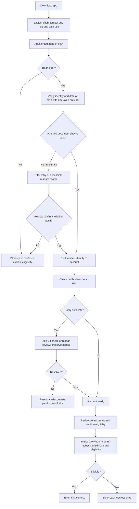

# Challenge 2 — AgeGuard proposal

## Design goals

Prevent under-18 users from entering cash-prize contests, reduce duplicate accounts, and keep adult onboarding proportionate. No single signal is sufficient: document authenticity, authoritative age confirmation, possession, and account linkage each address different failure modes. Behavioural trust can help prioritize a review, but it must never override an age-verification failure or missing age proof.

## User flow

## Verification and duplicate controls

Combine a declared date of birth with a trusted identity verification provider that checks document integrity and date of birth; use a liveness or selfie match only when risk, local law, accessibility, and proportionality justify it. Where legally available, an authoritative age-only token can reduce exposure to full identity data. Add device, payment-instrument, verified-identity token, and account-link signals to identify likely duplicate accounts, with step-up checks instead of automatic denial on a single shared household or device signal. Apply jurisdiction and contest eligibility checks immediately before entry.

Verification occurs before any cash-prize contest. If a check fails, explain the issue without exposing fraud rules, permit a limited correction/retry, and offer a documented manual review with an appeal route. Restrict cash contests while age remains unresolved. A successful behavioural or payment history never changes this gate.

## Privacy and trust boundaries

Collect only what is needed to decide age eligibility and account uniqueness. Prefer provider-issued pass/fail, age-threshold, and stable pseudonymous identity tokens over retaining document images or full birth dates. Encrypt transfers and stored records, restrict staff access, audit review activity, define deletion and retention periods, and disclose the processor and purpose before collection. Separate identity confidence (evidence that this is an eligible adult) from behavioural trust (signals about account misuse). Do not let the latter compensate for low identity confidence.

## Success measures

Track underage contest blocks and confirmed false accepts, duplicate-account detection precision/recall, adult verification completion and time, false-positive review rate, appeal reversal rate, retry success, support contacts, accessibility-related drop-off, and unnecessary personal-data retention. Segment operational measures to detect unfair friction while protecting sensitive attributes and small groups.
